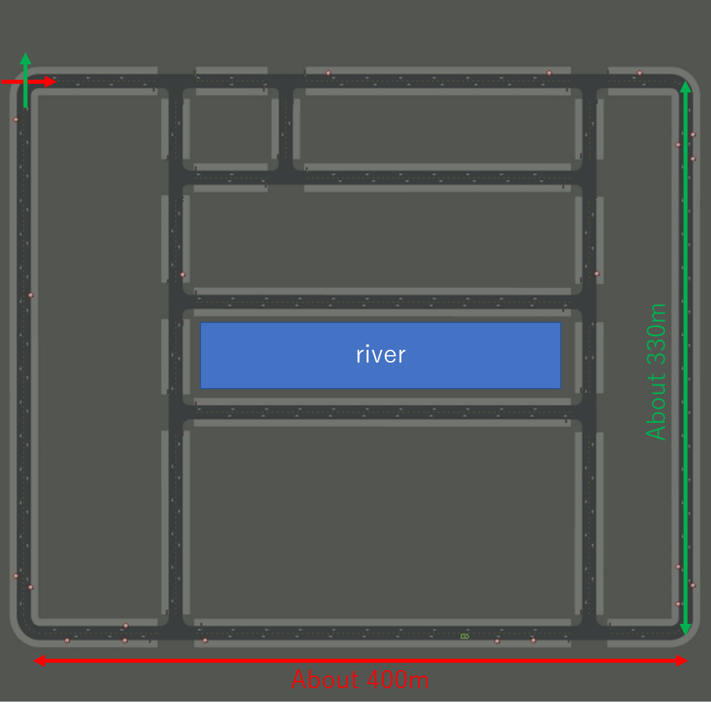

# CARLA2HDF5-v2

## 使い方

### 1. このリポジトリをクローンする

 ```sh
 git clone http://git-docker.tasakilab:5051/git/tasaki/carla2hdf5-v2.git
 ```

### 2. dockerイメージをビルドする

 ```sh
 cd carla2hdf5-v2/docker && ./build-docker.sh
 ```

### 3. dockerからX Window Systemへのアクセスを許可する（dockerの外で）

 ```sh
 xhost +
 ```

### 4. コンテナをそれぞれ別のターミナルで2つ立ち上げる

 ① サーバ用コンテナ
 ```sh
docker run --rm -it --privileged --gpus all --net=host -e DISPLAY=$DISPLAY carlasim/carla:0.9.14 /bin/bash ./CarlaUE4.sh -RenderOffScreen
 ```

 ② carla2hdf5用コンテナ
 ```sh
 ./run-carla2hdf5-docker.sh
 ```


### 5. 実行

 ②のターミナルで
 ```sh
 cd src && python carla2hdf5.py
 ```

### 6. GUI上で    

    a. 左側のInitial Settingsで`Connect`を押しサーバと接続する  
    b. 右側のTask Settingsの`Map`でマップを、`Weather`で天候を選択する  
    c. 右側のTask Settingsの`# Freames`で保存する枚数を、`# NPC *`でNPCの数を選択する  
    d. `Add Task`を押すことで開始される  

### 7. 終了したらX Window Systemへのアクセス許可を取り消す（dockerの外で）

 ```sh
 xhost -
 ```

## 障害物などを配置したい場合

### 配置手順
1. 物体の種類と設置位置姿勢を記述したjsonファイルを作成
2. extra objectのテキストボックスに作成したjsonファイルへのパスを書く

動作確認としてデフォルト設定の場合にテキストボックスに以下を設定すれば最初のデータに椅子や空飛ぶポストが出てくるはず
/workspace/config/extra_object.json

### jsonファイルの詳細
基本はextra_object.jsonを参考にすればわかるはず。
nameにはCarlaが提供している物体しか記述できない。[(記述できる物体一覧)](https://carla.readthedocs.io/en/latest/catalogue_props/)
座標系はh5ファイルのデータで作成する地図の座標系に準ずる。例えばTown01は以下のような座標系になる。(*carlaのUE座標系ではないのでご安心を)


## GUIを更新したい場合
### ui.pyの作り方
a. qtqreatorで.uiファイルを編集
b. 以下のコマンドでui.pyを作成
 ```sh
pyside2-uic carla2hdf5.ui > ui.py
 ```
### Qt Creatorの使い方
入力用テキストボックスを追加した時の操作手順
a. 画面左側にあるLabelとLine Editを配置した位置付近に置く
b. 初期設定だと縦にしか置けないので二つを選択して右クリックで「レイアウト->破棄」
c. 左右に並べて並べたいものだけ選択後、画面上部にある「|||」マーク(水平レイアウト)をクリック
d. 崩れてしまった他のレイアウトを戻すため、枠内のオブジェクトがない場所をクリックして画面上部にある「三」マーク(垂直レイアウト)をクリック